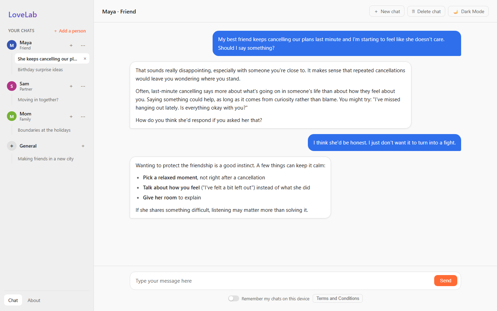
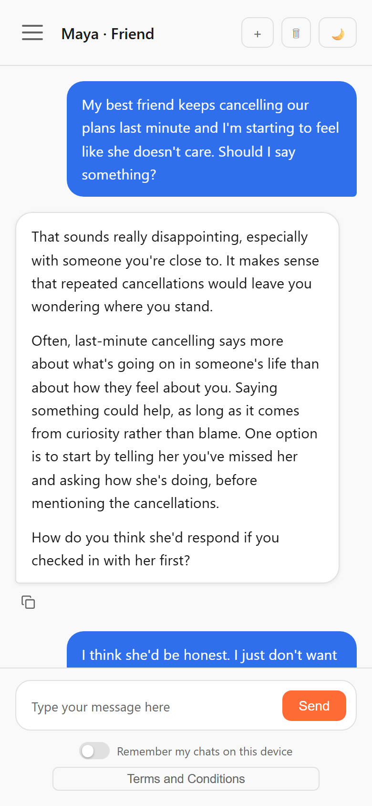
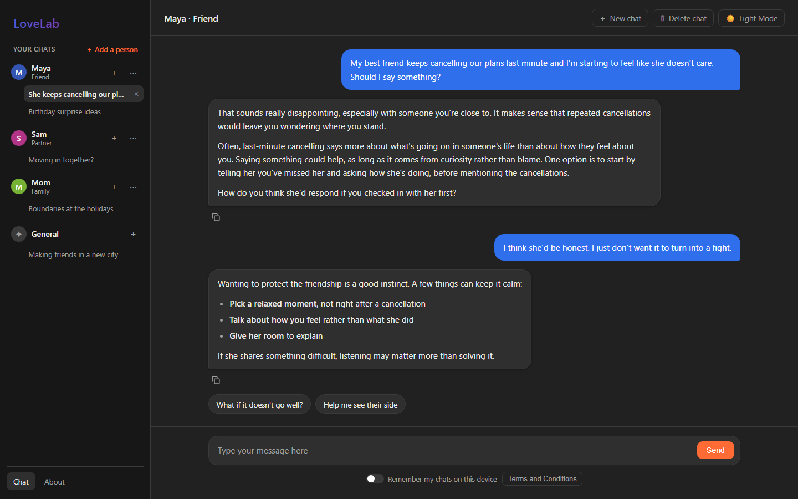
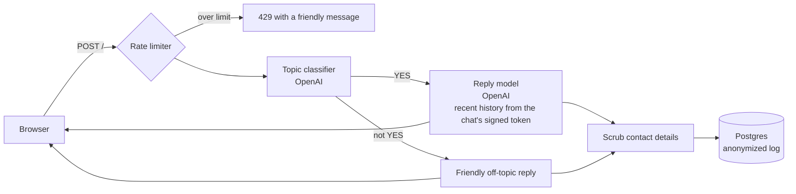

# LoveLab

An AI relationship-advice chat built with Flask and the OpenAI API. Talk through situations with a
partner, family, friends or coworkers and get warm, practical guidance, with no account needed.

**Live site:** [lovelab.app](https://www.lovelab.app)



<p align="center">
  
  &nbsp;&nbsp;
  
</p>

## Features

- **Chats organized by person.** Keep separate conversations about each person in your life.
- **Private by design.** No accounts, no cookies, and chats stay on your device unless you choose
  to remember them. Stored logs are anonymized.
- **Focused and safe.** Off-topic requests are gently declined, and messages about danger or
  self-harm are prioritized, with a caring reply and crisis resources.
- **Responsive.** Works on phones and large monitors, in light and dark mode.

## How a message flows through the app



## Privacy and safety design

| Concern | Approach |
|---|---|
| Prompt injection | Rules live in `instructions`, and user text is always passed as a separate message. The classifier treats the message as untrusted data and rejects attempts to change its task. The reply prompt tells the model to ignore role or persona changes. |
| Forged history | Each chat's recent history travels as a signed token (itsdangerous) that expires after 31 days. Tampered, expired or foreign-key tokens are ignored, and even a valid token only contributes `user` and `assistant` text. |
| Anonymous analytics | IPs are HMAC-hashed with a random secret that **rotates daily** and is then deleted. Messages from one visitor can be grouped within a day, but never linked to an IP address or across days. |
| Data kept by third parties | OpenAI calls use `store=False`, so conversations aren't kept for later retrieval in the OpenAI dashboard. |
| Shared devices | Chats are saved in `sessionStorage` (cleared when the tab closes) unless the visitor opts in to remembering, and remembered chats expire 30 days after their last message. The site sets no cookies, so deleting a chat on the device leaves nothing behind except the anonymized log. |
| Encryption in transit | In production, plain-HTTP requests are redirected to HTTPS (`308` for `POST`, so messages aren't silently dropped), and an `HSTS` header tells browsers to use HTTPS for the site from then on. |
| Cross-site attacks | A strict Content-Security-Policy (no inline scripts or styles), `X-Frame-Options: DENY`, and no cookies to steal or ride on. All user-supplied text, including people's names, is rendered with `textContent`, never as HTML. |
| Cost and availability | Per-call timeouts keep both OpenAI calls within Heroku's 30-second limit, automatic retries are off, and each reply has a hard token cap. A moving-window rate limit caps usage per visitor and globally, and only messages that reach OpenAI count toward it, so junk requests can't use up the site-wide limit. Page loads never touch the database. |
| Crisis situations | Both prompts treat safety as overriding the topic rule: the classifier is instructed to always let these messages through, and the reply model is instructed to share emergency, 988 and domestic-violence resources. |

## Tech stack

Python, Flask, SQLAlchemy, PostgreSQL, the OpenAI Responses API, plain HTML/CSS/JavaScript,
pytest, and Heroku.

## Running locally

Requires Python 3.11+.

```bash
python -m venv .venv
source .venv/bin/activate          # Windows: .venv\Scripts\activate
pip install -r requirements-dev.txt
python dev/preview_server.py       # http://127.0.0.1:5000, with canned AI replies
```

To run tests: `python -m pytest`

## License

Copyright © 2026 Sol Innovation. All rights reserved.

This source code is public so it can be viewed and reviewed. No license is granted to copy, modify,
distribute or reuse it, in whole or in part, without written permission.
