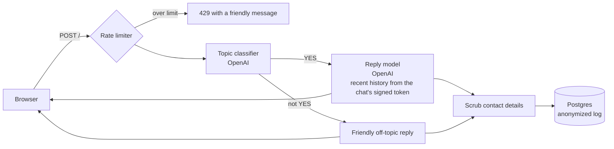

# LoveLab

An AI relationship-advice chat built with Flask and the OpenAI API. Visitors can talk through
situations with partners, family, friends or coworkers and get warm, practical guidance, without
creating an account and without their conversations being traceable back to them.

**Live site:** [lovelab.app](https://www.lovelab.app)


<p align="center">
  
  &nbsp;&nbsp;
  
</p>

## Features

- **Focused, safe conversations.** A classifier turns away off-topic requests with a friendly reply.
  Messages about self-harm, abuse or danger are always let through, and the model is instructed to
  respond with care and share crisis resources.
- **Chats organized by person.** Visitors add the people in their life (a partner, a parent, a coworker)
  and keep separate chats about each, all stored on their own device. Names never leave the browser.
- **Chats that survive a refresh.** An opt-in *Remember my chats on this device* setting keeps them
  across browser restarts for 30 days.
- **Visitor control.** Deleting a chat or a person erases it from the device, and with it the AI's
  memory, immediately. The server keeps no conversation state to delete.
- **Anonymous by design.** There are no accounts, IP addresses are never stored, and contact details
  are removed before anything is logged.
- **Responsive layout.** It scales from phones to 1440p monitors, with light and dark themes.

## How a message flows through the app



1. **Rate limiting** (Flask-Limiter, shared through Redis when available) applies per visitor and
   globally, to cap OpenAI costs.
2. **Topic classifier.** A small model call answers `YES` or `NO`. It sees LoveLab's previous reply,
   so short answers like "not really" are judged in context. It **fails closed**: anything other than a
   clear `YES` is treated as off-topic.
3. **Reply.** The main model receives the system prompt plus the chat's last few messages. Each chat's
   history travels as a **signed history token**: the server returns it with every reply, the browser
   stores it with that chat, and sends it back with the next message. The server is stateless, so
   visitors can keep many independent chats, and the signature stops anyone from inventing earlier
   messages.
4. **Logging.** The exchange is saved after removing emails, phone and card numbers, links and handles,
   under a visitor ID that can't be traced back to the visitor.

## Privacy and safety design

These are the parts I'd point to first.

| Concern | Approach |
|---|---|
| Prompt injection | Rules live in `instructions`, and user text is always passed as a separate message. The classifier treats the message as untrusted data and rejects attempts to change its task. The reply prompt tells the model to ignore role or persona changes. |
| Forged history | History tokens are signed with `SECRET_KEY` (itsdangerous) and expire after 31 days. Tampered, expired or foreign-key tokens are ignored, and even a valid token only contributes `user` and `assistant` text. |
| Anonymous analytics | IPs are HMAC-hashed with a random secret that **rotates daily** and is then deleted (on the first request of a new day, plus a scheduled `flask purge-visitor-salts`). Messages from one visitor can be grouped within a day, but never linked to an IP address or across days. |
| Data kept by third parties | OpenAI calls use `store=False`, so conversations aren't kept for later retrieval in the OpenAI dashboard. |
| Shared devices | Chats are saved in `sessionStorage` (cleared when the tab closes) unless the visitor opts in to remembering, and remembered chats expire 30 days after their last message. The site sets no cookies, so deleting a chat on the device leaves nothing behind except the anonymized log. |
| Encryption in transit | In production, plain-HTTP requests are redirected to HTTPS (`308` for `POST`, so messages aren't silently dropped), and an `HSTS` header tells browsers to use HTTPS for the site from then on. |
| Cross-site attacks | A strict Content-Security-Policy (no inline scripts or styles), `X-Frame-Options: DENY`, and no cookies to steal or ride on. All user-supplied text, including people's names, is rendered with `textContent`, never as HTML. |
| Cost and availability | Per-call timeouts keep both OpenAI calls within Heroku's 30-second limit, automatic retries are off, and a moving-window rate limit caps usage per visitor and globally. |
| Crisis situations | Both prompts treat safety as overriding the topic rule: the classifier always lets these messages through, and the reply model is instructed to share emergency, 988 and domestic-violence resources. |

## Tech stack

- **Backend:** Python, Flask, Flask-SQLAlchemy and Alembic (Flask-Migrate), Flask-Limiter, and the
  OpenAI Responses API
- **Database:** PostgreSQL (SQLite works locally)
- **Frontend:** plain HTML, CSS and JavaScript with no build step, using `rem`-based fluid scaling
- **Testing:** pytest (about 100 tests) and Playwright for browser previews
- **Hosting:** Heroku (gunicorn, Heroku Postgres, Key-Value Store, Scheduler)

## Project structure

```
app.py                  Flask app: config, models, OpenAI client, logging, routes
privacy.py              Contact-detail scrubbing for stored logs
templates/              Jinja templates (base layout, chat page, about page)
static/                 CSS, JavaScript, Terms and Conditions
migrations/             Alembic database migrations
tests/                  pytest suite (fake OpenAI client, in-memory SQLite)
dev/preview_server.py   Run the site locally with canned replies (no API key or database needed)
dev/live_preview.py     Auto-reloading browser windows and screenshots for design work
```

## Running locally

Requires Python 3.11+.

```bash
python -m venv .venv
source .venv/bin/activate          # Windows: .venv\Scripts\activate
pip install -r requirements-dev.txt
```

### Quick preview (no API key or database)

```bash
python dev/preview_server.py       # http://127.0.0.1:5000, with canned AI replies
```

For design work, run `python dev/live_preview.py` alongside it. It opens desktop and phone windows that
reload whenever a file in `static/` or `templates/` changes. This needs Playwright's browser, which you
install once with `python -m playwright install chromium`.

### Full app (real AI replies)

```bash
cp .env.example .env               # then add your OpenAI key and a SECRET_KEY
flask db upgrade                   # create the tables
python app.py
```

`.env.example` points at a local Postgres. For a quick start you can use SQLite instead:
`DATABASE_URL=sqlite:///lovelab.db`.

## Tests

```bash
python -m pytest
```

The suite uses a fake OpenAI client and an in-memory database, so it's free, offline and runs in under
a second. It covers routes, validation, the topic filter, conversation history and tampering, rate
limits, anonymized logging, contact-detail scrubbing, and the remember and delete features.

## Deployment (Heroku)

The `Procfile` runs migrations on release and serves the app with gunicorn. Set these config vars:

| Variable | Required | Purpose |
|---|---|---|
| `OPENAI_API` | Yes | OpenAI API key |
| `SECRET_KEY` | Yes | Signs history tokens (use a long random value; changing it makes the AI forget existing chats) |
| `DATABASE_URL` | Set automatically by Heroku Postgres | Database connection (`PG_URI` overrides it if set) |
| `REDIS_URL` | Set automatically by Heroku Key-Value Store | Shares rate-limit counts across workers |
| `OPENAI_MODEL`, `OPENAI_FILTER_MODEL` | No | Override the reply and classifier models |
| `OPENAI_REPLY_TIMEOUT`, `OPENAI_FILTER_TIMEOUT` | No | Per-call timeouts in seconds (default 18 and 8) |
| `CHAT_RATE_LIMIT`, `GLOBAL_CHAT_RATE_LIMIT` | No | Per-visitor and site-wide message limits |

Add **Heroku Scheduler** with a daily job, `flask purge-visitor-salts` at 00:10 UTC, so the previous
day's visitor-ID secret is deleted even when nobody visits.

## License

Copyright © 2026 Sol Innovation. All rights reserved.

This source code is public so it can be viewed and reviewed. No license is granted to copy, modify,
distribute or reuse it, in whole or in part, without written permission.
